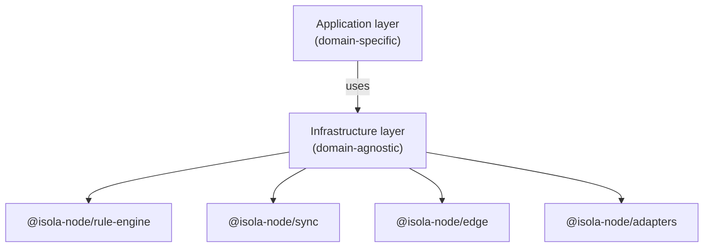

# Domain-Agnostic Infrastructure for Field-Deployed Systems

## Overview

We extracted four reusable, domain-agnostic infrastructure packages from a field-deployed decision-support system. Each package solves a concrete problem that recurs across environmental monitoring, edge computing, and any system that operates with intermittent connectivity.

The packages are independently versionable, self-hostable, and depend on no proprietary services. They are designed to be extracted into a standalone, neutral repository for the Open Internet Stack.

## Packages

### 1. @isola-node/rule-engine — Explainable rule engine

_Status: implemented._

A deterministic, auditable rule engine with offline learning.

- **Not AI** — no neural networks, no black boxes, no gradient descent.
- **Declarative rules** — human-readable, versionable, inspectable.
- **Adapter-based** — any domain plugs in with a custom `EvidenceAdapter`.
- **Conflict resolution** — heterogeneous sources vote and are weighted.
- **Offline capable** — runs without cloud connectivity.
- **Zero dependencies** — pure TypeScript.

Reusable for: any field where automated decisions must be transparent and auditable.

### 2. @isola-node/sync — Offline-first sync layer

_Status: interfaces defined; implementation in progress._

Edge-to-cloud synchronization for constrained devices in environments with intermittent connectivity.

- **MQTT 3.1.1 / 5.0** and **CoAP (RFC 7252)** transports.
- **Ring buffer** with monotonic sequencing (flash / SD / memory).
- **Conflict-free ordering** via per-device sequence numbers.
- **Works fully offline** — syncs when connectivity returns.
- **Zero dependencies** — pure TypeScript.

Reusable for: any edge-to-cloud deployment in low-connectivity contexts.

### 3. @isola-node/edge — Constrained device runtime

_Status: interfaces defined; implementation in progress._

A runtime that executes local rules, polls sensors, and buffers events on constrained hardware.

- **Targets**: Raspberry Pi, ESP32, ESP8266, generic microcontrollers.
- **Local rule execution** — safety-critical decisions without round trip.
- **Pluggable storage** — SQLite, flash, in-memory.
- **Pluggable GNSS** — optional.
- **Offline-first** — never blocks on network.

Reusable for: any sensor-driven application on constrained hardware.

### 4. @isola-node/adapters — Heterogeneous data source abstraction

_Status: mock implementation complete; sensor and satellite adapters are documented stubs._

A domain-agnostic adapter pattern for ingesting data from heterogeneous sources (local mocks, IoT sensors, satellite APIs) through a single generic interface.

- **`DataAdapter<T>`** — generic contract, no domain knowledge.
- **Discriminated union config** — type-safe factory via `createAdapter`.
- **Stub-vs-implementation separation** — honest, documented milestones.
- **Zero dependencies** — pure TypeScript.

Reusable for: any project that integrates multiple data sources without vendor lock-in.

## Alignment with Restack scope

| Restack area                 | Our contribution                                      |
| :--------------------------- | :---------------------------------------------------- |
| Trust-enhancing technologies | Auditable decisions; rules and weights always visible |
| Software supply chain        | Four independently versionable npm packages           |
| Infrastructure decoupling    | Self-hostable; no cloud lock-in; open protocols       |
| Deployability                | Modular, pre-configured components                    |
| Reproducibility              | Monorepo + CI + deterministic builds                  |
| Standards                    | MQTT, CoAP, STAC, COG, OGC, OpenAPI                   |

## Architecture

## What we explicitly do NOT do

- No machine learning of any kind.
- No cloud-only dependencies.
- No vendor lock-in.
- No proprietary protocols.
- No telemetry without user consent.
- No data collection beyond what the user explicitly shares.

## Origin

These packages were extracted from **SikeliaSoil**, a field-deployed decision-support system for regenerative agriculture in Mediterranean environments. The application layer remains domain-specific; the infrastructure layer is published independently for reuse.

## License

Apache 2.0. Everything open, everything forkable, everything self-hostable.

Copyright 2026 Carmen Maria Buendia Sanchez.
