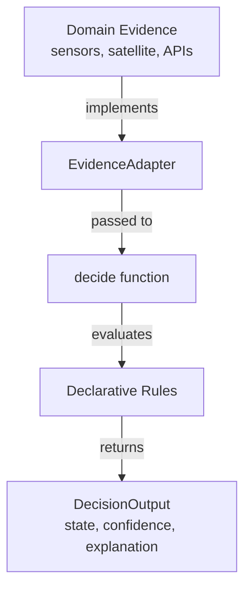

# @isola-node/rule-engine

An **explainable, deterministic rule engine** with offline learning.

## This is NOT AI

- **No neural networks**
- **No gradient descent**
- **No black boxes**
- **No machine learning of any kind**

The engine applies **declarative, human-readable rules** and produces decisions with full transparency: every decision shows which rules fired and their weights.

## Why this matters

In critical field deployments (agriculture, disaster response, environmental monitoring), a black-box decision is **useless**. You need to know **why**.

`@isola-node/rule-engine` provides:

- **Transparency**: every decision shows its evidence.
- **Auditability**: rules and weights are inspectable.
- **Determinism**: same inputs produce the same output.
- **Offline capability**: runs without cloud connectivity.
- **Domain-agnostic**: works for any evidence + rules pair via adapters.

## Architecture



## Install

pnpm add @isola-node/rule-engine

## Usage

```ts
import {
  decide,
  type EvidenceAdapter,
  type DecisionRule,
} from "@isola-node/rule-engine";

// 1. Define your adapter -- one per domain
const adapter: EvidenceAdapter<MyEvidence> = {
  read: (ev, path) => resolvePath(ev, path),
  detectConflicts: (ev) => [],
  sourcesUsed: (ev) => ["sensor1", "satellite2"],
};

// 2. Declare your rules -- plain objects, no code
const rules: DecisionRule[] = [
  {
    id: "soil_dry",
    label: "Soil is dry",
    conditions: [{ field: "sensors.soil_moisture", operator: "lt", value: 30 }],
    votesFor: "red",
    baseConfidence: 0.9,
    criteria: ["water"],
    version: 1,
    active: true,
  },
];

// 3. Get a decision
const output = decide(evidence, rules, adapter);

console.log(output.headline); // "Act now"
console.log(output.explanation); // "soil is dry"
console.log(output.firedRules); // [{ ruleId, weight, vote }]


## API

### `decide<TEvidence>(evidence, rules, adapter, options?)`

Produces a `DecisionOutput` from evidence, rules, and an adapter.

**Options** (`EngineOptions`):

- `weights?: Map<string, number>` -- override rule weights
- `headlineBuilder?: (state) => string` -- custom headline
- `explanationBuilder?: (state, fired) => string` -- custom explanation
- `confidenceCalculator?: (fired, state, conflicts) => number` -- custom confidence
- `ruleVersion?: string` -- version label

### `updateWeights(currentWeights, signals)`

Adjusts rule weights based on learning signals. No ML. Simple arithmetic.

### `buildLearningSummary(total, verified, correct, accuracy30dAgo?)`

Aggregates stats for the "learning summary" UI panel.

## Rule engine semantics

| Concept      | Meaning                                       |
| :----------- | :-------------------------------------------- |
| `state`      | `green` / `yellow` / `red` / `unknown`        |
| `conditions` | All must be true (AND)                        |
| `votesFor`   | Which state this rule supports                |
| `weight`     | Adjusted over time by feedback + verification |
| `conflicts`  | Disagreements between heterogeneous sources   |
| `confidence` | 0-1, penalized by conflicts                   |

## Zero dependencies

`@isola-node/rule-engine` has **no runtime dependencies**. Pure TypeScript. Works on Node, Deno, Bun, browsers, and edge runtimes (Cloudflare Workers, Vercel Edge, Deno Deploy).

## License

Apache 2.0 -- see [LICENSE](../../LICENSE).

Copyright 2026 Carmen Maria Buendia Sanchez.


```
