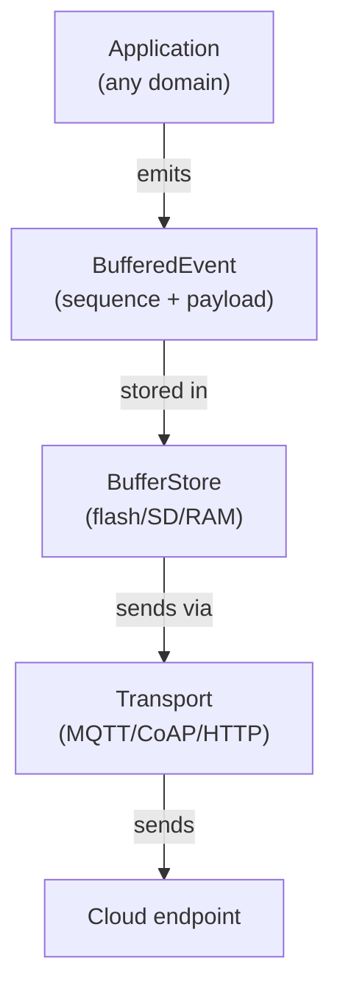

# @isola-node/sync

An **offline-first synchronization layer** for edge-to-cloud deployments in environments with intermittent connectivity.

## What it does

- **Buffers events locally** on constrained devices (Raspberry Pi, ESP32)
- **Flushes them to the cloud** when connectivity is available
- **Preserves ordering** via per-device monotonic sequence numbers
- **Works entirely offline**: syncs when possible, never blocks

## Standards

- **MQTT 3.1.1 / 5.0**: publish-subscribe for constrained devices
- **CoAP (RFC 7252)**: UDP-based for very limited devices
- **HTTP**: for gateways and testing

## Why this matters

Field deployments (agriculture, environmental monitoring, disaster response, citizen science) often operate in **rural areas with weak or intermittent connectivity**. Commercial sync solutions assume "always connected" or require proprietary cloud services.

`@isola-node/sync` provides a **vendor-neutral, self-hostable** alternative.

## Design principles

- **Zero dependencies**: pure TypeScript, works anywhere
- **Pluggable transports**: bring your own MQTT/CoAP/HTTP client
- **Pluggable buffer**: ring buffer on flash/SD, or in-memory
- **Standards-compliant**: no lock-in, no proprietary protocols

## Architecture

